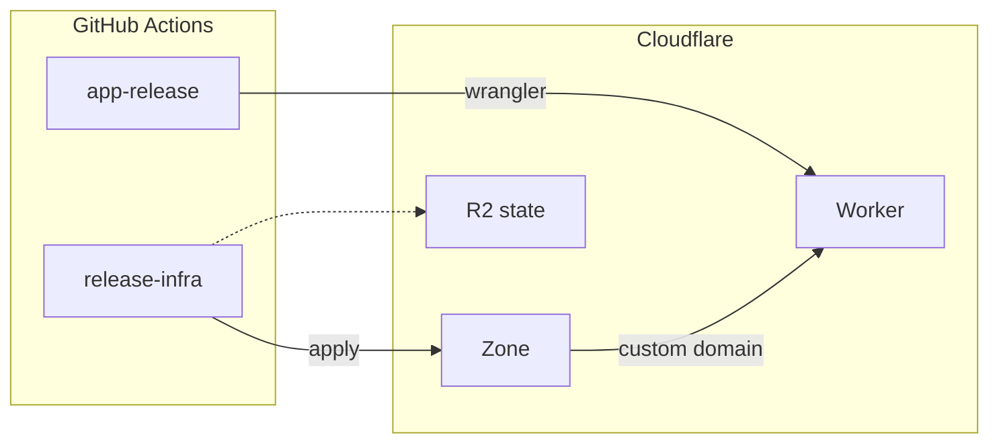
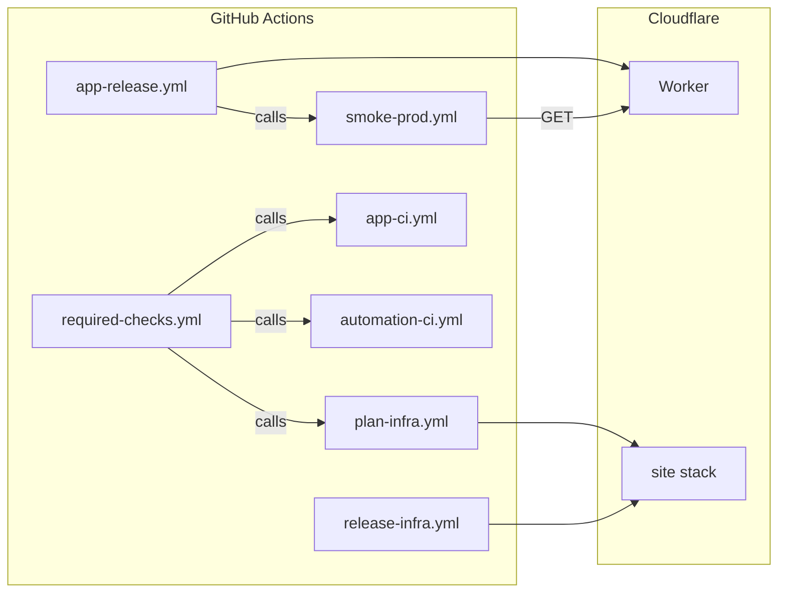

# koborin.ai


Technical proving ground for exploring AI, cloud architecture, and continuous learning.

The Astro site is served as Cloudflare Worker static assets. App deploys use wrangler. DNS and the custom domain are a TerraDart `site` stack applied from GitHub Actions.

## Architecture

The only public host is `koborin.ai`. There is no `dev.koborin.ai`.



| Abbreviation | Full Name | Description |
| --- | --- | --- |
| Worker | [Cloudflare Workers](https://developers.cloudflare.com/workers/) | Serves the static Astro site |
| Custom domain | [Workers custom domains](https://developers.cloudflare.com/workers/configuration/routing/custom-domains/) | Attaches `koborin.ai` to Worker `koborin-ai-web` |
| R2 | [Cloudflare R2](https://developers.cloudflare.com/r2/) | Terraform state bucket `koborin-ai-tfstate` |
| Wrangler | [Wrangler](https://developers.cloudflare.com/workers/wrangler/) | Uploads `app/dist` |

### Environment matrix

| Layer | Production (`koborin.ai`) |
| --- | --- |
| Runtime | Cloudflare Worker `koborin-ai-web` (static assets) |
| Access | Public |
| Content | Same MDX content (no env-specific filtering) |
| Analytics | GA4 + Giscus on article pages |

## CI/CD

Infrastructure and application deploys are each handled by dedicated GitHub Actions workflows. Cloudflare auth is a scoped API token.



| Workflow | Trigger | Purpose | Notes |
| --- | --- | --- | --- |
| `required-checks.yml` | Every PR | Maps changed paths to areas with `app/scripts/required-checks.ts`, calls the area workflows, and reports the `required-checks` job | The one check context to require |
| `plan-infra.yml` | Called for the infra area, or manual dispatch | `mise run check:infra` + `terraform plan` for the `site` stack | No apply |
| `release-infra.yml` | `main` infra push or manual dispatch | Applies the `site` stack | Runs only from `main`. State is in R2 |
| `app-ci.yml` | Called for the app area | Runs `npm run check` and the production build | Blocks merges that break the app |
| `automation-ci.yml` | Called for the automation area | `mise run check:automation` + `check:docs` (actionlint, shellcheck, label tests, markdownlint) | Guards the automation and the docs |
| `app-release.yml` | Merge to `main` or `workflow_dispatch` | Runs `npm run check`, builds the static site, runs `wrangler deploy`, then calls `smoke-prod.yml` | Runs only from `main`. Uses `CLOUDFLARE_API_TOKEN` |
| `smoke-prod.yml` | After each app deploy, weekly, or manual dispatch | Probes every route in `app/scripts/routes-baseline.txt` on `https://koborin.ai` | GETs only. No rollback |

Tool versions come from `.tool-versions`. `actions/setup-node` reads it through `node-version-file`, and the infra and automation workflows install from it with `jdx/mise-action`.

## Tech Stack

- **Frontend**: Astro and TypeScript. Home, article lists, talk lists, and articles share one centred column. Article pages use a wider measure than the home and list pages. Pagefind site search is gone.
- **Content Management**: MDX stored under `app/src/content/docs/` within git. Frontmatter is validated with Zod in `app/src/content.config.ts`. Drafts can be marked with `draft: true` in frontmatter.
- **Analytics**: Google Analytics 4 for baseline PV/engagement.
- **Infrastructure**: TerraDart (Dart) targeting Cloudflare via Terraform. State is in R2.
- **CI/CD**: GitHub Actions with a Cloudflare API token. `plan-infra.yml` / `release-infra.yml` drive infra; `app-ci.yml` / `app-release.yml` handle the Astro app.
- **Toolchain**: [mise](https://mise.jdx.dev/) pins Node, Dart, Terraform, actionlint, and shellcheck for both laptops and CI.
- **Quality gates**: oxlint and `astro check` for the app, Vitest for app unit tests, `dart analyze` + `dart test` for infra, actionlint and shellcheck for the automation, markdownlint for the docs. `mise run check` runs all of it.
- **LLM Context**: Machine-readable `llms.txt` files for AI assistants. Auto-generated at build time.

## LLM Context Files (llms.txt)

The site provides structured context files for LLMs at `https://koborin.ai/llms.txt`.

| File | Content |
| --- | --- |
| `/llms.txt` | Index with links to all variants |
| `/llms-full.txt` | All English articles (full Markdown) |
| `/llms-ja-full.txt` | All Japanese articles (full Markdown) |
| `/llms-tech.txt` | English tech articles only |
| `/llms-ja-tech.txt` | Japanese tech articles only |
| `/llms-life.txt` | English life articles only |
| `/llms-ja-life.txt` | Japanese life articles only |

These files are **auto-generated** at build time from Content Collections. Articles with `draft: true` are excluded. No runtime overhead.

## Repository Layout

```text
.
├── .tool-versions                 # Node, Dart, Terraform, actionlint, shellcheck
├── mise.toml                      # Repo-wide check tasks
├── app/                           # Astro application (static)
│   ├── wrangler.jsonc            # Worker name and dist/ assets
│   ├── .oxlintrc.json            # oxlint rules for TS and .astro scripts
│   ├── vitest.config.ts          # Vitest via Astro's getViteConfig
│   ├── src/
│   │   ├── assets/               # Images organized by category
│   │   │   ├── _shared/          # Common assets (header logo)
│   │   │   ├── tech/             # Tech article images
│   │   │   ├── life/             # Life article images
│   │   │   └── og/               # Open Graph images
│   │   ├── content/
│   │   │   └── docs/             # MDX pages: tech/, life/, ja/
│   │   ├── content.config.ts    # Zod schema for the docs collection
│   │   ├── data/
│   │   │   └── site-icons.json   # Hostname to data-URL favicons for link cards
│   │   ├── plugins/              # Asides, heading anchors, diagrams, and table frames
│   │   ├── utils/
│   │   │   ├── llms.ts           # Shared logic for llms.txt generation
│   │   │   └── llms.test.ts      # Vitest coverage for llms.txt rendering
│   │   ├── pages/                # Astro endpoints (llms.txt, RSS, article cards)
│   │   └── styles/
│   │       ├── prose.css         # Article body: the only stylesheet inside .sl-markdown-content
│   │       └── custom.css        # Leftover overrides outside the article body
│   ├── public/
│   │   ├── _headers               # txt charset, immutable /_astro cache, security headers
│   │   ├── favicon.png           # Browser tab icon
│   │   ├── og/                   # Open Graph source images
│   │   └── robots.txt
│   └── astro.config.ts           # Astro, MDX, sitemap, and Markdown plugins
├── docs/                          # Architecture notes, contact-flow specs, etc.
├── infra/                         # TerraDart site stack
│   ├── bin/synth.dart            # Synth entry point → tf-out/site/main.tf.json
│   ├── lib/                      # Stack definitions
│   │   └── site_stack.dart       # Zone lookup + Workers custom domain
│   ├── test/                     # dart test coverage for the synth output
│   └── pubspec.yaml              # TerraDart dependencies
├── .github/
│   ├── actionlint.yaml           # Self-hosted runner labels for actionlint
│   ├── scripts/                  # Shell helpers + their test suite
│   └── workflows/                # Required checks, infra plan and apply, app deploy, production smoke
├── README.md                      # This file
└── AGENTS.md                      # English operations guide for collaborators
```

### Brand Assets

| Asset | Location | Usage | Notes |
| --- | --- | --- | --- |
| Favicon | `app/public/favicon.png` | Browser tab icon | PNG format, transparent background recommended |
| Header Logo | `app/src/assets/_shared/koborin-ai-header-light.svg` / `-dark.svg` | Site header (replaces title text) | SVG, separate light/dark variants |
| Hero Image | `app/public/og/koborin-ai-hero.png` | Open Graph image for home and about | Not shown in the page. `Head.astro` rewrites the `.png` reference to `.webp` |

Logo size is set on `.nav-logo img` in `app/src/components/SiteHeader.astro`.

### Image Optimization (Automatic)

For performance, images are automatically converted to WebP format. **Authors can use PNG/JPEG normally** - optimization happens during build/deploy.

| Image Type | Location | What You Do | What Happens Automatically |
| --- | --- | --- | --- |
| Article cards | `/og/<page path>.webp` | Do not add a cover. The build draws the card from the title | WebP, 1200 by 630 |
| Home and about | `app/public/og/koborin-ai-hero.png` | Set `ogImage: /og/koborin-ai-hero.png` | CI converts to WebP; `Head.astro` rewrites `.png` to `.webp` |
| Blog images | `app/src/assets/{category}/{article}/` | Place PNG/JPEG in article folder | Astro optimizes to WebP |

Article pages open with the title and the dates. The social card is generated at build time from the title, at `/og/<page path>.webp`. Authors do not add a cover. Home and about still set `ogImage`. Inline images stay on `SiteImage` with `variant="inline"`.

`app/scripts/optimize-og-images.sh` still converts the root-level files in `app/public/og/` during CI. It does not write the generated article cards.

## Workflow Overview

1. **Infra changes**: edit TerraDart stacks → `mise run check:infra` → open PR → GitHub Actions runs `terraform plan` → reviewer approves → merge triggers apply of the `site` stack.
2. **App changes**: edit Astro/MDX → `mise run check` and `npm run build --prefix app` → PR runs `required-checks.yml`, which calls `app-ci.yml` → merge to `main` triggers `app-release.yml`, which runs `npm run check`, builds the static site, runs `wrangler deploy`, and then probes production with `smoke-prod.yml`.
3. **Content-only updates**: modify MDX under `app/src/content/docs/`, update frontmatter (`title`, `description`), run `mise run check:app`, open PR. Mark drafts with `draft: true` in frontmatter to exclude from production builds.

### Adding New Content

To add a new article or page:

1. **Create MDX file** under `app/src/content/docs/` (or subdirectory for categories):

   ```bash
   # Single page
   app/src/content/docs/my-article.mdx

   # Article
   app/src/content/docs/tech/my-post.mdx
   ```

2. **Add frontmatter** with required fields:

   ```yaml
   ---
   title: My Article Title
   description: Brief description of the article
   publishedAt: 2025-01-02
   ---
   ```

   - `publishedAt`: Set the publish date manually (YYYY-MM-DD format).
   - Updated date is automatically extracted from Git history at build time.

3. **Check the lists.** A page with `publishedAt` shows on the home page and on `/blog/` or `/ja/blog/`. Add its public URL to `app/scripts/routes-baseline.txt`.

4. **Build and test** locally before pushing.

## Release Strategy

- Infra applies run `release-infra.yml` for the `site` stack on a `main` push under `infra/`, or on a dispatch from `main`. `infra-v*` tags do not apply.
- App deploys run `app-release.yml` on a `main` merge under `app/`, or on a dispatch from `main`. The run checks, builds, deploys with `wrangler deploy`, and then probes production.
- GitHub release notes are generated via `.github/release.yml`. Label each PR with `app`, `infra`, `feature`, `bug`, or `doc` so the notes stay segmented by domain; apply the `ignore` label to omit a PR entirely.

## Local Setup

Tool versions live in `.tool-versions`, so [mise](https://mise.jdx.dev/) is the only prerequisite.

```bash
# Install mise once, then provision Node, Dart, Terraform, actionlint, shellcheck
curl https://mise.run | sh
mise install

npm install --prefix app

# Run Astro dev server
npm run dev --prefix app

# Run every quality gate (app + infra + automation)
mise run check
```

`mise run check` does not build the site. Run `npm run build --prefix app` for that. Both need Playwright Chromium (`npx playwright install chromium` in `app/`) to render Mermaid diagrams.

## Infrastructure Dev Notes

- TerraDart stacks are located in `infra/lib/`.
- Synth emits Terraform JSON via `dart run bin/synth.dart`.
- State is in R2: `koborin-ai-tfstate` / `terraform/site/terraform.tfstate`.
- Never run `terraform apply` locally. Apply goes through GitHub Actions.

### Site Stack

- **Zone lookup**: `data.cloudflare_zone` for `koborin.ai` (the zone is not created here).
- **Custom domain**: `cloudflare_workers_custom_domain` attaches Worker `koborin-ai-web` to `koborin.ai`.
- **Unmanaged DNS**: MX and GitHub organization verification TXT stay in the dashboard.

## Contact & Analytics Design (planned)

- Contact form will post to `/api/contact` (Astro API Route) with:
  - Payload validation (Zod), reCAPTCHA enforcement, structured logging.
  - Notification via SendGrid or Gmail API.
- `/api/track` endpoint will receive custom events.
- GA4 integration via gtag.js (injected at build time via `PUBLIC_GA_MEASUREMENT_ID`).

## Environment Variables

| Variable | Purpose | Where to Set |
| --- | --- | --- |
| `GA_MEASUREMENT_ID` | GA4 Measurement ID (e.g., `G-XXXXXXXXXX`) | GitHub Secrets |
| `GISCUS_REPO_ID` | Giscus repository ID for the comments widget | GitHub Secrets |
| `GISCUS_CATEGORY_ID` | Giscus discussion category ID | GitHub Secrets |
| `CLOUDFLARE_API_TOKEN` | Scoped token for wrangler and Terraform | GitHub Secrets |
| `CLOUDFLARE_ACCOUNT_ID` | Cloudflare account ID | GitHub Variables |
| `R2_ACCESS_KEY_ID` / `R2_SECRET_ACCESS_KEY` | Terraform state in R2 | GitHub Secrets |

`app-release.yml` writes GA and Giscus values into `app/.env` at build time as `PUBLIC_*`.

## Documentation

- `README.md`: quickstart + architectural highlights (this file).
- `AGENTS.md`: contribution workflow, review checklist, release rules, IaC philosophy.
