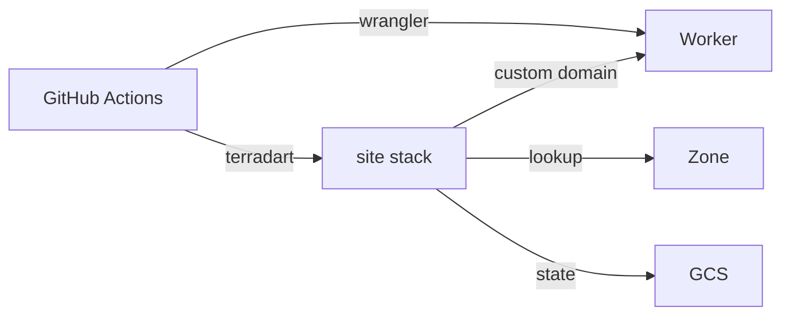

# koborin.ai

<!-- markdownlint-disable MD033 -->

<picture>
  <source media="(prefers-color-scheme: dark)" srcset="./assets/mark-lockup-dark.svg">
  
</picture>

<!-- markdownlint-enable MD033 -->

Software engineer. Building tools, thinking about life.

The site is an Astro app. Cloudflare Worker `koborin-ai-web` serves the built files as static assets. The only public host is `koborin.ai`.

## Architecture

GitHub Actions deploys the app with wrangler. The infra workflows run the terradart CLI on the TerraDart `site` stack. The stack looks up Cloudflare zone `koborin.ai` and attaches the Worker to that hostname. State lives in GCS bucket `koborin-ai-tfstate-n-koborinai`, at object `terraform/site/default.tfstate`. Plan and apply reach it through Workload Identity Federation, with no stored Google key.

`infra/pubspec.yaml` sets `terradart.engine` to `tofu` and pins `terradart_cli` at `0.35.0`. That release uses `tofu` when it is on `PATH`. When `tofu` is not on `PATH`, it downloads OpenTofu 1.13.1. The workflows do not install Terraform or OpenTofu.



Names in the diagram:

| Abbreviation | Full name | Description |
| --- | --- | --- |
| Worker | [Cloudflare Workers](https://developers.cloudflare.com/workers/) | Serves the static Astro site |
| Custom domain | [Workers custom domains](https://developers.cloudflare.com/workers/configuration/routing/custom-domains/) | Attaches `koborin.ai` to Worker `koborin-ai-web` |
| GCS | [Cloud Storage](https://docs.cloud.google.com/storage/docs) | Holds the `site` stack state |
| Wrangler | [Wrangler](https://developers.cloudflare.com/workers/wrangler/) | Uploads `app/dist` |

## Checks and deploys

`app/scripts/workflow-policy.ts` checks every workflow file. An action `uses` must be a 40-character SHA with a version comment. Permissions and concurrency must match the rules in that file. The `label` job in `label-pr.yml` is the only workflow job with `pull-requests: write`. That job skips forks. Only the jobs that hold the `terraform-state` group, and the `required-checks.yml` job that calls one, get `id-token: write`.

| Workflow | When it runs | What it does |
| --- | --- | --- |
| `required-checks.yml` | Pull request `opened`, `synchronize`, or `reopened` | Maps the diff with `app/scripts/required-checks.ts` and calls the area workflows below. The `required-checks` job fails when path detection fails, or when a changed area did not pass. A diff that matches no area passes. |
| `label-pr.yml` | Pull request `opened`, `synchronize`, `reopened`, or `edited` | Sets labels with `.github/scripts/compute-pr-labels.sh`. Skips a pull request that has the `ignore` label. |
| `app-ci.yml` | Called when the app area changes | Runs `npm audit --audit-level=critical --omit=dev`, `npm run check`, the production build, and Lighthouse. Scores are report-only. A missing report fails the job. The `lighthouse` artifact is kept for 14 days. |
| `automation-ci.yml` | Called when the automation area changes | Runs `mise run check:automation` and `mise run check:docs`. |
| `plan-infra.yml` | Called when the infra area changes, or `workflow_dispatch` | Runs `mise run check:infra`. The plan job then authenticates to Google Cloud and runs `dart run terradart_cli:terradart plan` for the `site` stack. The plan job skips Dependabot and fork pull requests. |
| `release-infra.yml` | Push to `main` under `infra/`, or `workflow_dispatch` | On `main`, checks the stack and authenticates to Google Cloud. Then it plans, runs `terradart apply --auto-approve`, plans again, and fails unless that plan is empty. |
| `app-release.yml` | Push to `main` on the path list below, or `workflow_dispatch` | On `main`, writes `app/.env`, runs `npm run check`, builds, and runs `npm run deploy`. Then it calls `smoke-prod.yml`. |
| `smoke-prod.yml` | After that deploy, Mondays at 04:23 UTC, or `workflow_dispatch` | On `main`, sends a GET for each public route in `app/scripts/routes-baseline.txt` on `https://koborin.ai`. Skips `/pagefind/`, `/_headers`, and `/_redirects`. |

Lighthouse reads `/`, `/ja/`, `/tech/koborin-ai-architecture/`, and `/ja/tech/koborin-ai-architecture/`, on desktop and mobile.

`app-release.yml` runs on a `main` push that changes `app/`, `.tool-versions`, `mise.toml`, `.github/workflows/app-release.yml`, or `.github/workflows/app-ci.yml`.

Node, Dart, actionlint, and shellcheck come from `.tool-versions`. `actions/setup-node` reads that file. Infra and automation workflows install it with `jdx/mise-action`.

## Set up locally

[mise](https://mise.jdx.dev/) installs the versions in `.tool-versions`. It does not install OpenTofu.

```bash
curl https://mise.run | sh
mise install
npm ci --prefix app
npm exec --prefix app -- playwright install chromium
```

Start the dev server:

```bash
npm run dev --prefix app
```

Run every check from the repository root:

```bash
mise run check
```

`mise run check` runs the app, infra, automation, and docs checks. It does not build the site. Build with:

```bash
npm run build --prefix app
```

App tests and the production build render Mermaid through Playwright Chromium. Install Chromium before `mise run check` or `npm run build`.

## Write a page

Add an article as MDX under `app/src/content/docs/`. English tech articles go in `tech/`. English life articles go in `life/`. Japanese articles go in the matching folder under `ja/`.

`tech/my-post.mdx` is served at `/tech/my-post/`. `life/my-post.mdx` is served at `/life/my-post/`. A Japanese file adds the `/ja/` prefix. The writing lists are `/blog/` and `/ja/blog/`. Article URLs stay under `/tech/` and `/life/`.

`title` and `description` are required. Set `publishedAt` to list the article and to generate its card.

```yaml
---
title: My article
description: One sentence summary.
publishedAt: 2026-10-28
---
```

Set `draft: true` while the page is unfinished. The production build, the home list, the writing list, RSS, and the `llms.txt` files omit drafts. `npm run dev` still renders a draft.

Add the new public URL to `app/scripts/routes-baseline.txt`. The build fails when a baseline URL is missing, or when it emits a URL that `app/scripts/check-routes.ts` does not allow.

Use `SiteImage` for an image file under `app/src/assets/`. Set `variant` to `inline` in an article, `card` on a list, or `thumbnail` for a small image.

The build draws `/og/<page path>.webp` from an article title. Home and about use `/og/koborin-ai-hero.webp`. Every other page uses `/og/index.webp`. The build draws those two cards as well.

## llms.txt

The build writes these files from published pages. Drafts are omitted.

| Path | Contents |
| --- | --- |
| `/llms.txt` | Index of the files below |
| `/llms-full.txt` | Every published English page, with its Markdown |
| `/llms-ja-full.txt` | Every published Japanese page, with its Markdown |
| `/llms-tech.txt` | Published English tech articles |
| `/llms-ja-tech.txt` | Published Japanese tech articles |
| `/llms-life.txt` | Published English life articles |
| `/llms-ja-life.txt` | Published Japanese life articles |

## Environment

`app-release.yml` writes GA and Giscus into `app/.env` when those secrets are set.

| Name | Where | What it sets |
| --- | --- | --- |
| `GA_MEASUREMENT_ID` | Secret | `PUBLIC_GA_MEASUREMENT_ID`, when the secret is non-empty |
| `GISCUS_REPO_ID` | Secret | `PUBLIC_GISCUS_REPO_ID`, when the secret is non-empty |
| `GISCUS_CATEGORY_ID` | Secret | `PUBLIC_GISCUS_CATEGORY_ID`, written in the same step as the repo id |
| `CLOUDFLARE_API_TOKEN` | Secret | wrangler deploy, and the Cloudflare provider for plan and apply |
| `CLOUDFLARE_ACCOUNT_ID` | Variable | Account id for deploy and for the `site` stack |
| `GCP_WIF_PROVIDER` | Variable | Workload Identity Federation provider for plan and apply |
| `GCP_SA_EMAIL` | Variable | Service account that reads and writes the state bucket |

The browser loads GA4 only after `localStorage` key `cookie_consent` is `accepted`. Giscus renders when both public ids are set, except on the home page. A page with `publishedAt` shows Giscus unless `engagement` is `false`. `engagement: true` shows Giscus on any other page.

## Brand

| Asset | Source | Served as |
| --- | --- | --- |
| Mark | `app/src/lib/mark.ts` | Header lockup, favicon tiles, and the card footer. `assets/mark-lockup-light.svg` and `assets/mark-lockup-dark.svg` use the same paths. |
| Favicons | `app/src/lib/icons.ts` | `/favicon.ico`, `/favicon.png`, `/favicon.svg`, `/apple-touch-icon.png`. `app/scripts/render-mark.ts` writes the dark tile for every theme. |
| Home and about card | `app/src/lib/og.ts` | `/og/koborin-ai-hero.webp` |
| Fallback card | `app/src/lib/og.ts` | `/og/index.webp` |

## Repository

| Path | What it holds |
| --- | --- |
| `app/` | Astro site, content, and the Worker asset build |
| `infra/` | TerraDart `site` stack |
| `.github/` | Workflows, the label script, and release notes |
| `assets/` | README lockup SVGs |

`AGENTS.md` is the operations guide. `mise.toml` defines `mise run check`. `.tool-versions` pins Node, Dart, actionlint, and shellcheck.
